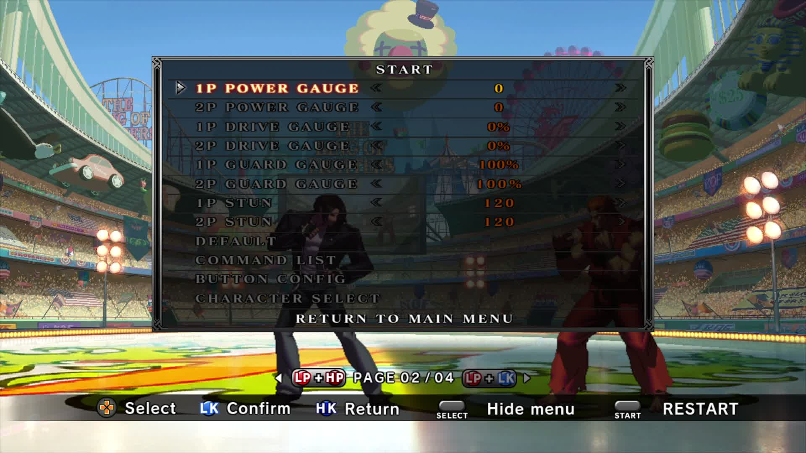

# KOF XIII Trainer + Native Hitboxes

Training tools for **THE KING OF FIGHTERS XIII GLOBAL MATCH on Steam**.

[Download Beta 7](https://github.com/PERFECTCOMBO/KOFXIII-Trainer-Hitboxes/releases/tag/v0.2.0-beta.7) · [Build the native components](BUILDING.md) · [License scope](THIRD-PARTY.md)

The custom native trainer, loaders and renderer adapters are now available as
open source under the MIT license. SNK's original game and renderer components
remain proprietary; see the source scope below.

## Features

- Expanded in-game training menu and five recording slots.
- RANDOM LOOP chooses among nonempty recordings and permits consecutive repeats.
- Native hitbox rendering inside the game; no separate viewer window required.
- Green pushboxes, blue hurtboxes and red attack boxes.
- Page 4 fill settings: Off, Light and Strong.
- Experimental save-state and reversal tools.

**No extra stages or stage replacements are included.** Use your existing game stages.

## Install the playable release

1. Download and extract the entire Beta 7 ZIP from Releases.
2. Close the game and any older viewer, then run `INSTALL.cmd`.
3. Paste the Steam game folder. Supported starting points are a clean supported
   Steam installation or the standalone Trainer Beta 6.
4. Launch through Steam, enter offline Practice and open page 4 for hitboxes.

Keep the backup folder created by the installer. `RESTORE.cmd` restores the
pre-install files. Unsupported executables or conflicting shared-file mods are
refused. Report the exact error or `installer-error.txt` when requesting help;
review it for local paths before sharing it.

## Training menu

Training-menu screenshot, showing page 2 of 4. Background artwork belongs to SNK;
no stage assets are distributed in this repository or the Beta 7 package.

## Source download

[Download the MIT-licensed native source ZIP](KOFXIII-Native-Source-beta7.zip?raw=true).
Extract it to obtain the source tree, build scripts, tests and license notices.
The directories below are inside that archive.

## Source scope

- `native/`: trainer/recording implementation, game hooks, loaders and renderer.
- `snk-renderer/original-adapter.h`: custom adapters for the original draw loop.
- `extract-snk.py`: generates excluded SNK headers from local, hash-verified inputs.
- `tests/`: focused recording regressions, including selection with five slots.
- `installer/`: Beta 7 installation/restore tooling and file-verification metadata.

The genuine SNK draw loop and collision shaders are **not included as open-source
code**. Building that renderer requires the matching debug executable locally;
no matching PDB is needed. The trainer bridge can be built without it.
See [BUILDING.md](BUILDING.md) for both paths.

The release's modified game Lua/GFX menu resources and their editing pipeline
are not part of this source release. Building these native DLLs therefore does
not rebuild the entire playable ZIP from source. Install the existing Beta 7
menu resources for integration testing. No `game.exe`, generated SNK headers,
recordings, saves, credentials or local machine paths are included in the
source files published here.

## Validation and limitations

The cleaned native source builds all four DLLs using MSVC x86. Focused recording
regressions pass, including repeats and five-slot selection. A prior live Steam
check selected slots `1, 5, 5, 3, 4, 3, 2, 4`; random mode does not promise that
repeats or ascending runs will never happen.

Hitbox colors/fill and OBS Game Capture were previously verified in Practice.
This source publication does not change the Beta 7 download or installed game.
The complete ten-category color chart is not implemented. Save states and
reversals remain experimental; full-roster, controller and combined-package
coverage is incomplete. Other graphics hooks can conflict with capture.

## License and contributions

Custom code: [MIT](LICENSE). Viewer-derived work retains the notice in
[licenses](Original-KOF13-Hitbox-Viewer.txt). SNK resources and screenshot
artwork are excluded; read [THIRD-PARTY.md](THIRD-PARTY.md).

Bug reports and pull requests are welcome. Include the game version, reproduction
steps and relevant logs with personal paths removed. Do not upload game binaries,
private recordings, saves, proprietary generated headers or credentials.

Unofficial project; not affiliated with or endorsed by SNK or Valve.
